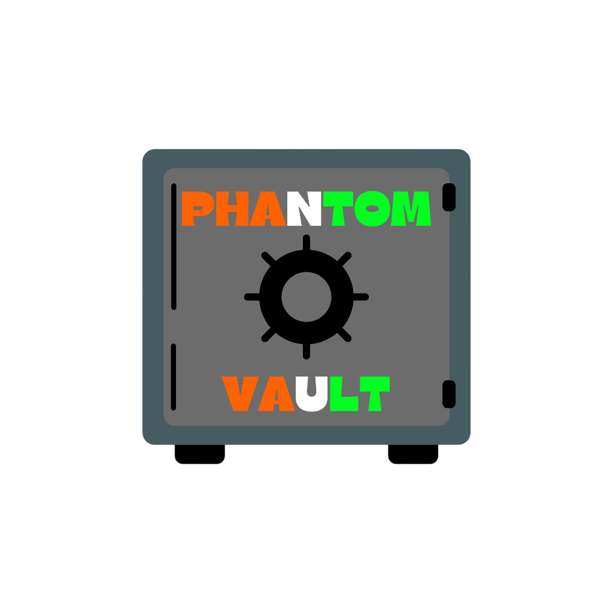

# 📦 PHANTOMVAULT — Required Packages & Dependencies Specification

<div align="center">

<p align="center">
  
</p>

### *Trust Nothing. Reveal Nothing.*

[-0B0D12?style=for-the-badge&logo=windows11&logoColor=39D0C8)](https://microsoft.com/windows)
[](https://dotnet.microsoft.com/)
[](https://learn.microsoft.com/windows/apps/winui/winui3/)
[](file:///d:/projects%20and%20certificates/projects/apps/PHANTOMVAULT/README.md)
[-0B0D12?style=for-the-badge&logo=1password&logoColor=7C83FF)](file:///d:/projects%20and%20certificates/projects/apps/PHANTOMVAULT/README.md)
[](file:///d:/projects%20and%20certificates/projects/apps/PHANTOMVAULT/README.md)

<br/>

<p align="center">
  
</p>

</div>

---

## 📋 Table of Contents
1. [💻 System Requirements](#-system-requirements)
2. [📦 Required Packages & Dependencies (With Real-Life Logos)](#-required-packages--dependencies-with-real-life-logos)
   - [Desktop UI & Presentation Shell](#1-desktop-ui--presentation-shell)
   - [Cryptography, Security & Hardware Biometrics](#2-cryptography-security--hardware-biometrics)
   - [Storage, In-Memory Steganography & Audio Subsystem](#3-storage-in-memory-steganography--audio-subsystem)
   - [Automated Testing & Verification Suite](#4-automated-testing--verification-suite)
3. [📥 Dependency Restoration & Verification](#-dependency-restoration--verification)
4. [🚀 How to Run Guide Reference](#-how-to-run-guide-reference)

---

## 💻 System Requirements

| Specification | Minimum Requirement | Recommended Specification |
| :--- | :--- | :--- |
| **Operating System** | Windows 10 (version 1809+ / build 17763) | Windows 11 (build 22000+) with Mica Alt support |
| **Architecture** | 64-bit (`win-x64` or `win-arm64`) | 64-bit Intel / AMD x64 or ARM64 |
| **Processor** | Dual-Core 2.0 GHz CPU | Quad-Core 2.8+ GHz (accelerates Argon2id lanes) |
| **System Memory (RAM)** | 4 GB RAM | 8 GB+ RAM (enables instant multi-file chunking) |
| **Disk Storage** | 350 MB free space | 1 GB+ free space for encrypted vaults |
| **Biometric Sensor** | None (Password authentication) | Windows Hello compatible fingerprint or IR camera |
| **Audio Hardware** | Standard Windows audio driver | 16-bit 44.1 kHz PCM playback device |
| **Developer Tools** | [.NET 8.0 SDK](https://dotnet.microsoft.com/download/dotnet/8.0) *(Only if building from source)* | Visual Studio 2022 v17.10+ / Windows App SDK |

---

## 📦 Required Packages & Dependencies (With Real-Life Logos)

All external dependencies in PHANTOMVAULT have been strictly audited for **zero remote telemetry, zero analytics tracking, and zero network socket leakage**.

### 1. Desktop UI & Presentation Shell

| Real-Life Logo | Package / Dependency | Version | Target Project | Purpose & Security Rationale |
| :---: | :--- | :---: | :--- | :--- |
|  | **[Microsoft.WindowsAppSDK](https://www.nuget.org/packages/Microsoft.WindowsAppSDK/)** | `1.6+` | `PhantomVault.App` | Core native Windows desktop application platform providing modern WinUI 3 controls, dynamic `MicaKind.BaseAlt` deep obsidian backdrop, and fluid system compositor. |
|  | **[Microsoft.Windows.SDK.BuildTools](https://www.nuget.org/packages/Microsoft.Windows.SDK.BuildTools/)** | `10.0.*` | `PhantomVault.App` | Native Windows header compilation, XAML compiler Pass 1/2 markup generation, and MSIX-free unpackaged Win32 bootstrapper. |
|  | **[CommunityToolkit.Mvvm](https://www.nuget.org/packages/CommunityToolkit.Mvvm/)** | `8.3.2` | `PhantomVault.App` | High-performance, source-generated MVVM pattern implementation (`ObservableObject`, `ObservableProperty`, `RelayCommand`) with zero reflection overhead. |
|  | **[Microsoft.Extensions.DependencyInjection](https://www.nuget.org/packages/Microsoft.Extensions.DependencyInjection/)** | `8.0.0` | `PhantomVault.App` | Enterprise Inversion-of-Control (IoC) container managing decoupled cryptographic services, repository lifetimes, and view models. |

---

### 2. Cryptography, Security & Hardware Biometrics

| Real-Life Logo | Package / Dependency | Version | Target Project | Purpose & Security Rationale |
| :---: | :--- | :---: | :--- | :--- |
|  | **[Konscious.Security.Cryptography.Argon2](https://www.nuget.org/packages/Konscious.Security.Cryptography.Argon2/)** | `1.3.1` | `PhantomVault.Security` | Winner of the Password Hashing Competition (RFC 9106). Configured with **64 MiB memory hardness, 4 iterations, 4 parallelism lanes** to render GPU/ASIC attacks computationally prohibitive. |
|  | **[System.Security.Cryptography.AesGcm](https://learn.microsoft.com/dotnet/api/system.security.cryptography.aesgcm)** | `Built-in .NET 8` | `PhantomVault.Security` | Authenticated symmetric cipher encrypting files in **64 KiB chunks** with 128-bit authentication tags, chunk-index binding, and unique CSPRNG nonces per chunk. |
|  | **[Windows.Security.Credentials.UI (UserConsentVerifier)](https://learn.microsoft.com/uwp/api/windows.security.credentials.ui.userconsentverifier)** | `WinRT Native` | `PhantomVault.Infrastructure` | Hardware-backed biometric identity authentication (Fingerprint, IR Facial recognition, PIN) backed by TPM to securely unseal vaults. |
|  | **[CryptographicOperations.ZeroMemory](https://learn.microsoft.com/dotnet/api/system.security.cryptography.cryptographicoperations.zeromemory)** | `Built-in .NET 8` | `PhantomVault.Security` | Explicit memory zeroization wiping plaintext keys, derived key material, and unencrypted RAM buffers immediately after use. |
|  | **DoD 5220.22-M Sanitizer** | `Native Custom` | `PhantomVault.Infrastructure` | Military-grade file shredding: 3-pass overwrite (0x00, 0xFF, CSPRNG noise), file truncation, timestamp scrambling, and MFT GUID renaming. |

---

### 3. Storage, In-Memory Steganography & Audio Subsystem

| Real-Life Logo | Package / Dependency | Version | Target Project | Purpose & Security Rationale |
| :---: | :--- | :---: | :--- | :--- |
|  | **[Microsoft.Data.Sqlite](https://www.nuget.org/packages/Microsoft.Data.Sqlite/)** | `8.0.10` | `PhantomVault.Storage` | Local zero-configuration database engine providing atomic ACID transactions, isolated per-vault catalogs, and encrypted indexing. |
|  | **[System.Drawing.Common](https://www.nuget.org/packages/System.Drawing.Common/)** | `8.0.10` | `PhantomVault.Steganography` | High-fidelity pixel manipulation for PNG scanlines, extracting and embedding encrypted bits into least significant bits (LSB) with zero perceptual degradation. |
|  | **Win32 Multimedia API (`winmm.dll`)** | `Native Windows` | `PhantomVault.App` | Ultra-low latency, zero-disk-trace audio engine. Synthesizes 16-bit PCM 44.1 kHz WAV streams directly in RAM for tactical cyber acoustic feedback. |
|  | **Decoy Vault Engine** | `Native Custom` | `PhantomVault.Infrastructure` | Plausible deniability subsystem that seamlessly unseals realistic decoy files under duress, concealing authentic vaults with zero key exposure. |

---

### 4. Automated Testing & Verification Suite

| Real-Life Logo | Package / Dependency | Version | Target Project | Purpose & Security Rationale |
| :---: | :--- | :---: | :--- | :--- |
|  | **[xunit](https://www.nuget.org/packages/xunit/)** | `2.9.3` | `PhantomVault.*.Tests` | Industry-standard unit test framework verifying cryptographic correctness, chunk ordering, tamper rejection, and stego integrity. |
|  | **[xunit.runner.visualstudio](https://www.nuget.org/packages/xunit.runner.visualstudio/)** | `3.1.5` | `PhantomVault.*.Tests` | Visual Studio and CLI test discovery and runner integration for `dotnet test`. |
|  | **[Microsoft.NET.Test.Sdk](https://www.nuget.org/packages/Microsoft.NET.Test.Sdk/)** | `17.14.1` | `PhantomVault.*.Tests` | Core MSBuild targets and entry points required for test execution. |
|  | **[coverlet.collector](https://www.nuget.org/packages/coverlet.collector/)** | `6.0.4` | `PhantomVault.*.Tests` | Cross-platform code coverage analysis ensuring full test coverage across all security interfaces. |

---

## 📥 Dependency Restoration & Verification

To restore and verify all packages across the entire solution:

```powershell
# Restore all NuGet packages for all projects
dotnet restore PHANTOMVAULT.sln

# Build solution in Release mode to ensure all package assemblies resolve
dotnet build PHANTOMVAULT.sln -c Release --no-restore
```

---

## 🚀 How to Run Guide Reference

For execution instructions, standalone launch options, CLI developer mode, and operational guides, see:
👉 **[HOW-TO-RUN.md](file:///d:/projects%20and%20certificates/projects/apps/PHANTOMVAULT/HOW-TO-RUN.md)**

---

<div align="center">

**PHANTOMVAULT** • *Trust Nothing. Reveal Nothing.*

Designed for Windows 10 & 11 • Local-First Cryptographic Privacy

</div>
